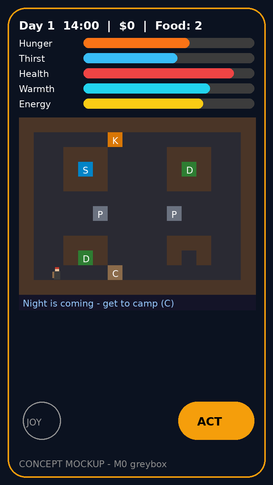

# 🏕️ Cardboard Kingdom — Homeless Simulator

**By VN** · Free · Offline · No ads · No in-app purchases · Android

Go from sleeping under a bridge with $0 and a shopping cart to either
getting back on your feet — or building the finest cardboard kingdom the
city has ever seen. Played with empathy, not mockery.

*Concept mockup of the M0 greybox screen — real art lands in the M1 pass.*

## M0 greybox — what works right now

- 🗺️ **One district** in the fictional cold city of Frostgate: streets,
  soup kitchen, shelter, dumpsters, benches, and your camp under the bridge
- 🕹️ **Touch controls:** virtual joystick + tap-to-move, context ACT button
- ⏰ **Live clock:** 1 real minute = 1 game hour, day counter, night tint
- 📊 **Survival stats:** hunger, thirst, health, warmth, energy (0–100),
  money, carried food
- 🍲 **Eat & survive:** dumpster food (3 finds/day), free soup-kitchen
  meal (1/day), shelter warm-up (1/day), bench rest
- 🛏️ **Sleep:** full rest at camp, rough sleep anywhere else — both
  advance to morning
- 💀 **Game over:** health at 0 → days-survived recap + restart
- 💾 **Autosave:** JSON save every game hour and on sleep; resume on launch
- ⏸️ **Pause + help card** explaining every control

## What's next (M1+)

Economy (begging, busking, odd jobs, recycling, pawn shop), camp building
(tent → shack → crew), NPCs and story quests, weather seasons, real sprite
art. Full design: [PLAN.md](PLAN.md).

## Install

1. Get the APK from **GitHub Releases** (rolling `latest` build, auto-built
   from `main` on every push — link appears once the repo is published).
2. Allow "install unknown apps" for your browser when prompted (normal for
   sideloading; APK is signed with the debug key).
3. If Android shows "App was denied access" when enabling anything:
   Settings → Apps → Cardboard Kingdom → ⋮ → **Allow restricted settings**.

## Honest status

- ✅ Game math validated: 58/58 mock tests green (`tests/`)
- ✅ Build setup copied from doomscroll-guard's proven CI config
- 🔲 **Not yet compiled or run on a real device** — CI build is the next
  verification step after the repo is created (see below)
- 🔲 Art is greybox blocks; real sprite packs land in M1
  (swap map: [docs/ASSET_SWAP.md](docs/ASSET_SWAP.md))

## Sprite credits (packs planned for the M1 art pass)

- Kenney — Tiny City — CC0
- muchopixels — City Street Tileset Pack — see itch.io page
- BloodyFish — Pixel Streets — CC0 (demo free)
- Defected Pixel Artist — Top-Down Town Pack — free on itch.io
- Ruzty — Survival Player Character — free base (custom beanie/beard/sign
  layer pass to be added)
- MutterPixel — Cozy Pixel City Street — itch.io

## Tests

`tests/game_math_tests.py` ports `GameState.kt` exactly and covers
drains, clamping, winter-night worst case, sleep variants, daily limits,
movement cost, and a 3-day survival loop. Run: `python3 tests/game_math_tests.py`

## Tone note

This game treats homelessness as a human struggle, not a joke. The
game-over screen lists real shelter resources (call 211 in Canada/US).
No punch-down humor, no gore, no pay-to-win.

## License

MIT — see [LICENSE](LICENSE).
